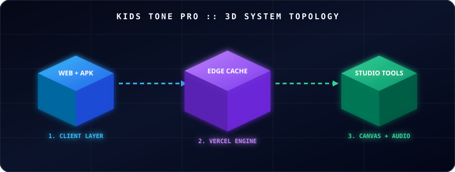

<!-- 3D Cylinder Holographic Banner -->

<!-- Animated Cyber Typing Effect -->

 

<!-- 3D Neon Launch Buttons -->

  
  

 

<!-- Custom 3D Isometric System Architecture -->

---

### 🌐 Direct Production Access

| Access Channel | Live Endpoint | Status |
| :--- | :--- | :--- |
| 🚀 **Live Web Application** | **[https://kids-tone-pro.vercel.app](https://kids-tone-pro.vercel.app)** | 🟢 `ONLINE (EDGE CACHED)` |
| 🏢 **Engineering Studio** | **[https://rktechsolution.vercel.app](https://rktechsolution.vercel.app)** | 🟢 `VERIFIED PRODUCTION` |
| 📱 **Mobile Build** | **Android APK + Responsive PWA** | 🟢 `READY TO INSTALL` |

---

### ⚡ 3D Core Engineering Modules

<table>
  <tr>
    <td width="50%" valign="top">
      <h4>🎬 Zero-Lag Streaming Engine</h4>
      <ul>
        <li><b>1-Hour Smart Edge Caching:</b> Instant feed loading with zero redundant network overhead.</li>
        <li><b>Infinite Auto-Scroll Feed:</b> Smooth hardware-accelerated vertical video transitions.</li>
        <li><b>Touch-Lock Fullscreen Mode:</b> Prevents accidental screen taps during playback.</li>
      </ul>
    </td>
    <td width="50%" valign="top">
      <h4>🎹 Interactive Creative Studio</h4>
      <ul>
        <li><b>HTML5 Canvas Draw Pad:</b> Real-time multi-color vector sketching with instant reset.</li>
        <li><b>Web Audio Synthesizer Piano:</b> Zero-latency polyphonic touch keys built in pure JS.</li>
        <li><b>Native Android Wrapper:</b> Packaged as a lightweight, signed Android APK.</li>
      </ul>
    </td>
  </tr>
</table>

---

### 🛠️ Production Stack

---

### 👨‍💻 Engineered By

**Rameshwar Kharade** • Founder & Full-Stack Engineer at **[RK Tech Solutions](https://rktechsolution.vercel.app)**  
[🌐 Live Agency Store](https://rktechsolution.vercel.app) • [🚀 Kids Tone PRO Live](https://kids-tone-pro.vercel.app) • [💻 GitHub](https://github.com/rameshwarkharade001-byte)

